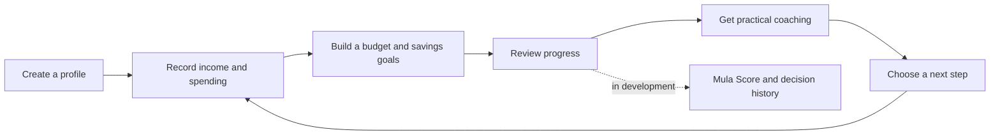
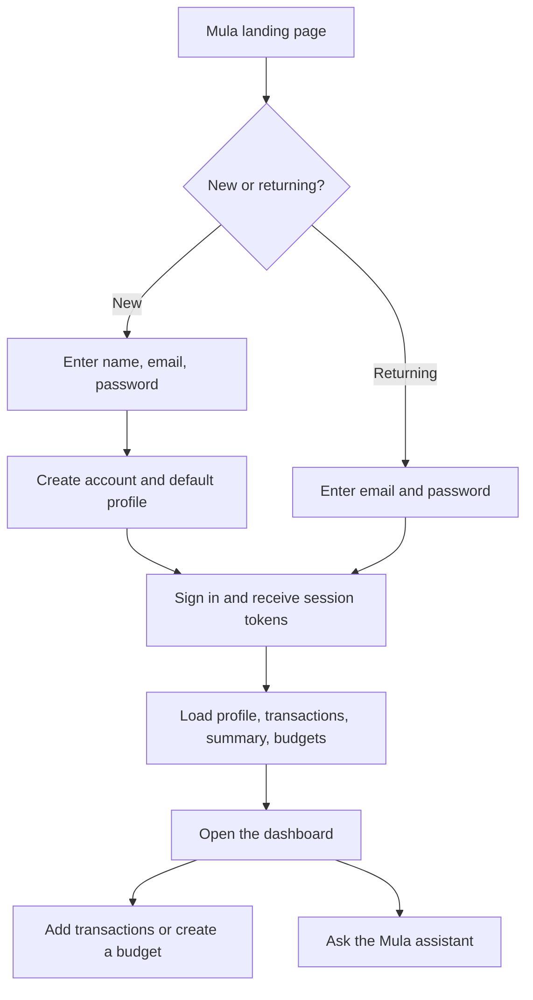
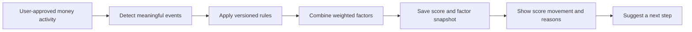
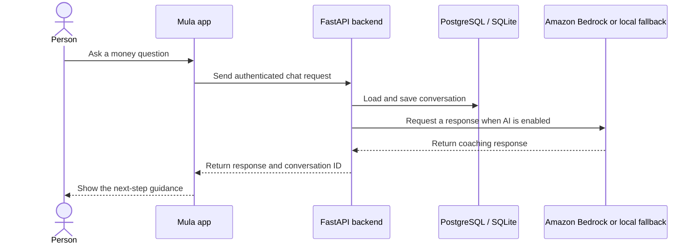

# Mula

**Know where your money goes. Feel clearer about what to do next.**

Mula is a Kenya-first personal finance platform that brings spending, budgets,
savings goals, and practical coaching into one experience. It is designed to
help people build steadier financial habits, one understandable decision at a
time.

> Mula is an educational financial wellness product. It is not a credit bureau
> score, lender, or substitute for professional financial advice.

## The product

People often manage money across multiple accounts, bills, and informal
commitments. Mula helps bring that picture together, make a realistic plan, and
turn financial activity into useful next steps.



## Features

| Capability | What it does | Status |
|---|---|---|
| Personal finance records | Store transactions, income, expenses, budgets, and savings plans | Backend APIs and data models are in place |
| Budget planning | Organize money around needs, wants, and savings | Budget APIs are in place; guided product experience is evolving |
| AI money coach | Chat about budgeting and financial questions, with saved conversation history | Chat API is in place; AWS model use is optional |
| Mula Score | Explain how habits such as bill payments and savings relate to financial health | In development; not a credit bureau score |
| M-Pesa and financial connections | Reduce manual entry by connecting financial activity | Planned integration |
| Business finance tools | Support cash-flow planning and business insights | Future product phase |

The current backend provides account, transaction, financial-planning, and
assistant foundations. Some experiences and integrations remain under active
development.

## First-time onboarding and sign-in

The current onboarding is intentionally short. A new user chooses **Create
account**, enters their name, email, and password, and is signed in after the
account is created. Returning users sign in with email and password. The API
hashes passwords, creates a default profile, and issues access and refresh
tokens.



New users go straight to the dashboard; the current app does not require a
lengthy questionnaire or a bank connection before they can begin. Currency
defaults to KES, and users can start by entering transactions and setting up a
budget. The score-consent field defaults to off. Google sign-in is supported by
an API endpoint, but it is not yet connected to the current sign-in screen.

## Mula Score: a different kind of algorithm

Mula Score is designed to answer a different question from a conventional
credit score. Instead of estimating whether someone should receive credit, it
aims to show how their everyday financial habits are developing and what they
could improve next. It is a personal financial-health measure, not a lender
rating or a credit bureau score.

The planned algorithm is **behavior-based, deterministic, and explainable**:

1. With the user's consent and at least 30 days of financial history, Mula
   looks for meaningful events such as paying a bill on time, meeting a savings
   goal, or overspending a budget.
2. Each event contributes to one or more financial-health factors.
3. A versioned rules engine combines the factor results into a score and saves
   a snapshot.
4. Mula shows the factors and events behind the result, so a user can see what
   helped, what hurt, and what action to consider next.



The design groups behavior into five factors:

| Factor | Planned weight | Examples of what it considers |
|---|---:|---|
| Payment consistency | 30% | On-time bills and repayments |
| Savings behavior | 25% | Regular saving and progress toward goals |
| Spending discipline | 20% | Budget adherence and spending patterns |
| Debt management | 15% | Repayment progress and reliance on short-term borrowing |
| Financial stability | 10% | Income regularity and maintaining a balance buffer |

This makes Mula Score a **financial-habit algorithm**, not a renamed credit
score: savings and budgeting behavior count alongside debt and payments, and
the intended output is personal guidance rather than a lending decision. The
weights and 300–850 display range are the current design; they may change as
the rules are developed and reviewed. Exact event point values and the final
conversion from factor results to the displayed range are not finalized.

The number is intended to come from backend rules, never from an AI model. AI
may explain a recorded score change in plain language, but it must not invent
or change the score. The score engine, score API, and simulator are still in
development; the current code has data models for snapshots, factors, and
events, but does not yet calculate a live Mula Score.

## How the AI coach works

Mula keeps the AI in a supporting role: it can explain and coach, while
financial calculations and product rules belong in the application.



## AWS services

| AWS service | How Mula uses it | Why |
|---|---|---|
| **Amazon Bedrock Runtime** | Optional AI inference through the Converse API, using Amazon Nova Lite and Nova Micro | Nova Lite handles chat and reasoning-oriented requests; Nova Micro handles quick categorization requests |

Bedrock is enabled with `AI_PROVIDER=bedrock`. The backend includes rate
limiting, retries for temporary service errors, and a local fallback when
Bedrock is disabled or unavailable. AWS access is provided through Boto3 and
the configured AWS credentials or runtime role.

For local development, store AWS credentials in `backend/.env`. Use
`AWS_ACCESS_KEY_ID` and `AWS_SECRET_ACCESS_KEY` for an IAM key pair, or
`AWS_BEARER_TOKEN_BEDROCK` for a Bedrock bearer API key. The bearer token setting
is optional; use a runtime role or short-lived credentials in deployed services.

**Amazon Bedrock Runtime is the only AWS service currently integrated in this
repository.** The application uses Neon for hosted PostgreSQL and SQLite for
local development. AWS hosting, storage, queues, and authentication services
are not currently configured.

## Technology

- **Frontend:** React, TypeScript, Vite
- **API:** Python, FastAPI, SQLAlchemy
- **Database:** PostgreSQL on Neon; SQLite for local development
- **Database schema:** SQLAlchemy models; local development creates tables on startup
- **AI:** Amazon Bedrock Nova, with a local fallback

## Run locally

Requirements: Node.js and pnpm for the frontend, plus Python 3.12 for the backend.

```bash
# Frontend
cd frontend
cp .env.example .env.local
pnpm install
pnpm dev
```

In a second terminal:

```bash
# Backend
cd backend
python3.12 -m venv .venv
source .venv/bin/activate  # Windows: .venv\Scripts\activate
python -m pip install -r hela_backend/requirements.txt
test -f .env || cp .env.example .env
./run-local.sh
```

The public Mula introduction runs at `http://localhost:5173`; choose **Get
started** or visit `/app` to sign in and use the finance app. The API runs at
`http://localhost:8000`; API documentation is at `/docs`. For Neon configuration,
see [Database and Neon setup](./docs/database-and-neon.md).

For backend-only setup, database behavior, health checks, and troubleshooting,
see the [FastAPI backend guide](./backend/README.md).

## Product direction

Mula is being built around three principles:

1. **Clarity:** make money activity and trade-offs easier to understand.
2. **Practicality:** turn insight into small, achievable next steps.
3. **Trust:** explain how guidance is produced and keep sensitive financial
   features consent-based.

Read the [user story](./docs/user-story.md) for the intended customer journey,
or [tech.md](./tech.md) for the broader architecture.
